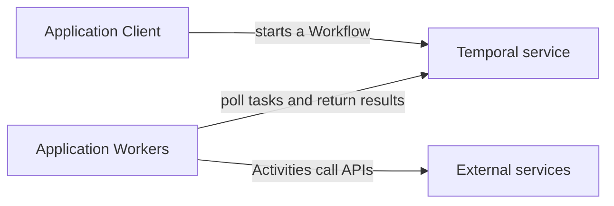

# Reading the architecture

Lesson 1 of 4 · About 6 minutes · [All lessons](../README.md)

## Learning goal

Explain where application code runs and distinguish a customer’s business framework from Temporal’s responsibilities.

## Starting with the case

The published LORA diagram places Gateway, Schema and Task services above two Go Workers: LPW for automated work and LTW for human tasks. The case study says they use separate Temporal Task Queues. These names describe BFI’s application architecture. [Source: BFI case study](https://temporal.io/resources/case-studies/bfi).

Read the original diagram as a map of responsibilities. Its arrows do not show every runtime interaction.

| Component | Question to ask while reading |
| --- | --- |
| Gateway Service | Where do application requests enter? |
| Schema Service | Where are business data contracts defined? |
| Task Service and back-office users | How does a person receive and complete work? |
| LPW and LTW | Which application code handles each kind of work? |
| Temporal Server | Where is execution progress coordinated and recorded? |
| Third-party services | Which actions depend on an external system? |

## The Temporal concepts underneath

A Client starts or interacts with a Workflow Execution. A Workflow defines coordination logic. An Activity performs a task such as calling an API. Workers execute both kinds of code by polling Temporal Task Queues and returning results. Temporal’s service records execution history and coordinates progress. [Source: Workers](https://docs.temporal.io/workers).

This simplified responsibility map is an illustration for learning, not a reproduction of BFI’s topology:

In words: the Client requests work through Temporal; Workers obtain tasks from Temporal; Activity code on those Workers calls external systems.

## Connect it to the existing example

In [client.ts](../../my-app/src/client.ts), the Client submits a greeting request. [workflows.ts](../../my-app/src/workflows.ts) defines its steps, [activities.ts](../../my-app/src/activities.ts) contains the greeting task and [worker.ts](../../my-app/src/worker.ts) hosts the application code.

A larger architecture adds services and Worker groups around the same concepts. A diagram alone cannot establish reliability, throughput or the cost of operating it.

For the music-submission concept, an API could accept a demo, a Workflow could coordinate review, and an Activity could send a notification. The team would still build the API, review interface and notification integration. This is a proposed design.

## Check your understanding

1. If Temporal’s service is available but every application Worker is stopped, what can happen to a newly submitted execution?
2. Does using Temporal Cloud mean the customer no longer runs Workers?
3. What would justify separate Worker groups in a small application?

## Answer guide

1. The service can accept work, but application tasks wait for a suitable Worker. This matches the recorded Worker-availability experiment.
2. The customer still operates the application Workers. Cloud manages the Temporal service.
3. Different scaling, access or operational requirements might justify separation. Reproducing a customer diagram without those needs would add complexity.

## Proposed practice — not yet performed

Annotate the music-submission process with Client, Workflow, Activity, Worker and external-service responsibilities. Explain who operates each component and what happens if it stops. This is a design exercise; it does not require building BFI’s service layout.

For a customer conversation: “When a service is unavailable, where does the work wait, and who has to get it moving again?”

Next: [Waiting for human review](02-waiting-for-human-review.md).
